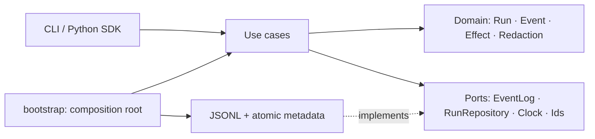

<p align="center">
  
</p>

<h1 align="center">FORKED</h1>
<p align="center"><b>Open Counterfactual Computing Infrastructure</b><br>
<i>Explore what could have happened. Verify what changed.</i></p>

<p align="center">
  <a href="https://github.com/MauricioFonck/forked/actions/workflows/ci.yml"></a>
  
  
  
  
</p>

---

You change one prompt, one tool result, one model — and your AI agent behaves differently.
**Was it your change, or did the API answer differently, the clock move, the random seed
shift, or the retry hit a different replica?** Comparing two runs is not an experiment.

FORKED is an open-source, local-first research runtime that turns "let me re-run it and see"
into a **controlled counterfactual experiment**: capture an execution, fork it at a
checkpoint, change exactly one declared thing, keep external side effects under a
default-deny policy, and get an evidence report that says what was held constant, what
changed, and **what remains unknown**.

> **Status — honest version.** Pre-alpha. **Recording, inspection and replay of recorded
> observations work and are tested.** Branching, comparison and evidence export are designed
> but not implemented. Nothing here is scientifically validated yet. See [roadmap](#roadmap).

## 60-second demo

```bash
git clone https://github.com/MauricioFonck/forked && cd forked
uv sync                      # https://docs.astral.sh/uv/ — installs Python if needed
uv run forked record toy-agent
```

```text
recorded run_693f3f8963f040b376839fd6e36c9676
status     completed (recorded: completed)
adapter    forked-toy-agent 0.1.0
events     8 (sequence valid: True)
capture    100% of declared points
redacted   1 event(s)
omitted    0 event(s)
limitation get_exchange_rate is a local stub with a fixed rate table; no network call is made
limitation send_email writes to a local outbox directory; no email is sent
limitation the demo api_key is fake and exists only to demonstrate redaction
missing evidence: none detected
```

```bash
uv run forked inspect <run_id> --events   # every event, its effect class and capture status
uv run forked inspect <run_id> --json --strict   # machine-readable; exit 1 if evidence is missing
uv run forked replay <run_id>             # re-run the workflow from the recording: 0 tools execute
```

The toy agent converts a currency, checks a policy and "emails" finance. Every tool call is
recorded with its **effect class** (`pure_local`, `external_read`, `external_write`, …), the
fake API key is **redacted before it touches disk**, and the report states its own
limitations. Kill the process mid-run and `inspect` reports the run as **incomplete**, listing
exactly which declared capture points were never observed — a partial recording is never
passed off as a complete one.

`replay` runs the **same workflow code** again, but every tool call is answered from the
recording: nothing executes, so the "email" is not sent twice. The replay is strict and fails
closed — a call with different inputs, an extra call, a missing or omitted observation, or a
recorded call never requested all stop the replay with an explicit error instead of quietly
calling the real tool. It reproduces *recorded observations*, not the original environment.

## Why this is different

| | Plain logs / tracing | Framework time-travel | **FORKED** |
|---|---|---|---|
| Records what happened | ✅ | ✅ | ✅ typed, ordered, redacted events |
| Says what was **not** captured | ❌ | ❌ | ✅ explicit missing-evidence list |
| Classifies side effects | ❌ | app-specific | ✅ CIP effect taxonomy, default-deny *(policy: Phase 3)* |
| Branch with a declared intervention | ❌ | ✅ (one framework) | 🛠 Phase 3, framework-neutral |
| Invariants as `verified / violated / unknown` | ❌ | ❌ | 🛠 Phase 3 |
| Portable, offline-verifiable evidence | ❌ | ❌ | 🛠 Phase 4 |

FORKED **complements** OpenTelemetry, LangGraph, Temporal, Phoenix and LangSmith — it does
not replace them. See the scoped [competitive landscape](docs/03-competitive-landscape.md).

## What FORKED is — and is not

**Is:** a local-first capture and branching research runtime · a protocol and evidence format
(CIP) for counterfactual experiments · a safety layer for side effects · a benchmark suite
for replay fidelity, branch isolation and evidence completeness.

**Is not:** a foundation model or agent framework · a production orchestrator · a guarantee of
deterministic replay for arbitrary software · a causal-inference oracle. A hash proves that
bytes did not change — not that a conclusion is true.

## Roadmap

| Phase | Scope | State |
|---|---|---|
| 0 | Repository foundation, architecture, CI, policies | ✅ done |
| 1 | Local recorder, redaction, JSONL store, inspector, CLI | ✅ done |
| 2 | Replay of recorded observations, fail closed, no tool executes | ✅ done |
| 3 | Branch lineage, one intervention type, default-deny effect policy, invariants | 🛠 next |
| 4 | Evidence package (SHA-256 manifest) + offline verifier | planned |
| 5 | OpenTelemetry bridge, first framework adapter, FCRB benchmark | planned |
| 6 | Public alpha, docs site, community | planned |

Details and exit criteria: [`docs/09-roadmap-and-backlog.md`](docs/09-roadmap-and-backlog.md).

## Architecture in one picture

Hexagonal (ports & adapters) inside a modular monolith. The core knows nothing about
files, CLIs, frameworks or model providers — a guardian test fails the build if it ever does.



`src/forked/` → `domain/` · `application/` (+ `ports/`) · `adapters/inbound` · `adapters/outbound` · `bootstrap/`.
Event schema v0.1.0: [`spec/cip/v0.1/event.schema.json`](spec/cip/v0.1/event.schema.json).

## Documentation

| | |
|---|---|
| [Project charter](docs/01-project-charter.md) | Mission, scope, users, non-goals |
| [Problem & hypotheses](docs/02-problem-and-research-hypotheses.md) | Falsifiable hypotheses H1–H5 and the causal-language boundary |
| [Competitive landscape](docs/03-competitive-landscape.md) | LangGraph, Temporal, Phoenix, OTel GenAI, LangSmith |
| [Product requirements](docs/04-product-requirements.md) | UC-01…UC-05, FR-001…FR-015 |
| [Architecture](docs/05-architecture.md) · [ADR-001](docs/14-adr-001-hexagonal-architecture.md) | Hexagonal modular monolith |
| [CIP protocol draft](docs/06-cip-protocol-draft.md) | Event envelope, effect taxonomy, claim levels |
| [Security & privacy](docs/07-security-and-privacy.md) | Threat model and secure replay matrix |
| [Benchmarks & validation](docs/08-benchmarks-and-validation.md) | FCRB scenarios and metrics |
| [Decisions & open questions](docs/12-decisions-and-open-questions.md) | What is decided and what still needs evidence |
| [Diagrams](docs/diagrams.md) · [References](docs/references.md) | |
| [`contexto/`](contexto/README.md) | Maintainers' engineering memory (Spanish): sessions, impact analyses, ADRs, failures |

## Principles

1. Evidence before claims. 2. Explicit boundaries around replay guarantees. 3. Safe-by-default
external effects. 4. Provider and framework neutrality. 5. Open formats and documented APIs.
6. Privacy-preserving, local-first operation. 7. Reproducible benchmarks and independent review.

## Contributing

The most valuable contributions now: adversarial test cases, review of the CIP draft, and
attempts to break our claims. Read [CONTRIBUTING.md](CONTRIBUTING.md) and
[SECURITY.md](SECURITY.md).

## License

Code: [Apache-2.0](LICENSE). Documentation: CC BY 4.0. See [GOVERNANCE.md](GOVERNANCE.md).
