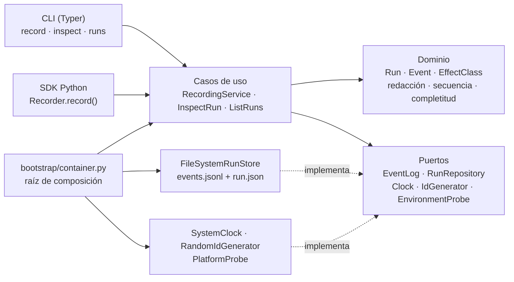

# `contexto/` — Memoria central de FORKED

Es la **puerta de entrada** para quien llega al proyecto, sea persona o IA. Desde aquí se llega a todo documento de
`contexto/` siguiendo enlaces, y un guardián lo comprueba en cada `uv run pytest`
([`test_context_graph.py`](../tests/guardians/test_context_graph.py)). Las reglas de trabajo están en
[`CLAUDE.md`](../CLAUDE.md) / [`AGENTS.md`](../AGENTS.md); esta memoria explica **el sistema** y te dice **dónde mirar**.

**Cómo usarla.** Lee §1 y §2 una vez. Para una tarea concreta, ve a §3 («Voy a tocar…»). Para ubicar un contexto, una
decisión o un término, usa §5 a §10. En la vista de grafo de Obsidian es el nodo central: todo índice de área enlaza de
vuelta aquí con `↑ Memoria central`.

> **Idioma.** Esta memoria está en español. El código, la documentación pública (`docs/`, `README.md`) y los mensajes
> de commit están en inglés, para que cualquier contribuidor pueda leerlos ([ADR-006](forked/decisiones-arquitectura/ADR-006-idioma.md)).

## Contenido

1. [FORKED en cinco líneas](#1-forked-en-cinco-líneas)
2. [Cómo leer esta memoria](#2-cómo-leer-esta-memoria)
3. [Voy a tocar… → leo primero](#3-voy-a-tocar--leo-primero)
4. [Arquitectura de un vistazo](#4-arquitectura-de-un-vistazo)
5. [Contextos acotados (módulos)](#5-contextos-acotados-módulos)
6. [Protocolo CIP](#6-protocolo-cip)
7. [Investigación: hipótesis, benchmark y arte previo](#7-investigación-hipótesis-benchmark-y-arte-previo)
8. [Decisiones de arquitectura por tema](#8-decisiones-de-arquitectura-por-tema)
9. [Fallos que enseñan un concepto](#9-fallos-que-enseñan-un-concepto)
10. [Glosario](#10-glosario)
11. [Mapa de áreas](#11-mapa-de-áreas)
12. [Mantenimiento](#12-mantenimiento)

---

## 1. FORKED en cinco líneas

- Runtime de investigación **open source y local-first** para hacer **experimentos contrafactuales controlados** sobre
  flujos de software y ejecuciones de agentes de IA: capturar, bifurcar, cambiar **una** variable declarada y reportar
  qué se mantuvo constante, qué cambió y **qué sigue sin saberse**.
- **Python ≥ 3.11**, monolito modular con **arquitectura hexagonal** (puertos y adaptadores). El dominio solo usa la
  biblioteca estándar; Pydantic y Typer viven en los bordes.
- Persistencia local: **JSONL append-only** por run + metadatos `run.json` reemplazados de forma atómica. Sin nube, sin
  telemetría, sin red obligatoria.
- **Seguridad por defecto:** redacción de secretos antes de persistir; efectos externos clasificados con la taxonomía
  CIP y **denegados por defecto** en replay y ramas (el replay no ejecuta ninguna herramienta; la política de
  decisión llega con las ramas en la Fase 3, [ADR-010](forked/decisiones-arquitectura/ADR-010-replay-estricto-sin-politica.md)).
- Hoy funcionan las **Fases 0 y 1** (cimientos + grabador local). Estado vivo en
  [`forked/estado-actual.md`](forked/estado-actual.md); visión completa en
  [`forked/contexto-general.md`](forked/contexto-general.md); plan en [`forked/roadmap.md`](forked/roadmap.md).

## 2. Cómo leer esta memoria

**Jerarquía de verdad.** Cuando dos fuentes se contradicen, manda la de arriba y se corrige la de abajo:

1. El **código** y sus tests.
2. [`CLAUDE.md`](../CLAUDE.md), los [ADR](forked/decisiones-arquitectura/README.md) y los README de contexto
   (`modulos/<contexto>/README.md`). Un ADR posterior refina a `docs/` cuando lo dice explícitamente.
3. La documentación de producto en [`docs/`](../docs/01-project-charter.md) (la propuesta original, en inglés).
4. La spec y el plan de cada trabajo ([`docs/superpowers/`](docs/superpowers/README.md)).
5. Lo histórico (ver abajo).

**Qué está vigente y qué es histórico.** Se distingue por la carpeta:

| Histórico: cuenta lo que pasó, no cómo está hoy | Vigente |
|---|---|
| [`sesiones/`](sesiones/README.md) · `impacto/AAAA-MM-DD-*` · [`revisiones/`](revisiones/README.md) | Todo lo demás |

Un documento vigente que quedó viejo lleva arriba `> ⚠️ Obsoleto desde AAAA-MM-DD: reemplazado por …`.

**Qué no puede romperse.** Los comportamientos protegidos (`CP-nnn`) están en
[`impacto/comportamientos-protegidos.md`](impacto/comportamientos-protegidos.md), cada uno con el test que lo cuida.
Antes de cambiar algo se escribe su [impacto](impacto/README.md); al cerrar, su [bitácora](sesiones/README.md).

## 3. Voy a tocar… → leo primero

| Tarea | Lee primero | Y la trampa a evitar |
|---|---|---|
| **Captura y eventos** (sobre, secuencia, estados) | [Contexto `runs`](modulos/runs/README.md) · [Sobre de evento](protocolo/sobre-de-evento.md) · [Ciclo de vida del run](diagramas/ciclo-de-vida-run.md) | La secuencia la asigna **solo** el agregado `Run`; un borrador inválido no consume número (CP-002) |
| **Redacción de secretos** | [Pipeline de captura](diagramas/pipeline-captura.md) · [ADR-007](forked/decisiones-arquitectura/ADR-007-omitir-no-truncar.md) | Todo texto libre (mensajes de excepción) pasa por el pipeline antes de tocar disco (CP-005) |
| **Persistencia** (JSONL, `run.json`) | [Contexto `runs`](modulos/runs/README.md#persistencia) · [ADR-004](forked/decisiones-arquitectura/ADR-004-persistencia-fase-1.md) | Una línea truncada o malformada falla cerrada con su número de línea; nunca se salta (CP-012) |
| **El esquema del evento** | [Versionado](protocolo/versionado.md) · [`spec/cip/v0.1/`](../spec/cip/v0.1/event.schema.json) | Regenerar con `scripts/export_schemas.py`; **nunca** editar un fixture dorado publicado (CP-016) |
| **Replay** | [Contexto `replay`](modulos/replay/README.md) · [ADR-010](forked/decisiones-arquitectura/ADR-010-replay-estricto-sin-politica.md) · [Spec 003](docs/superpowers/specs/003-replay-de-observaciones/spec.md) | En replay `call_tool` **no tiene camino** hacia `fn`; toda duda falla cerrado (CP-022…025) |
| **Efectos y política** (Fase 3) | [Taxonomía de efectos](protocolo/taxonomia-de-efectos.md) · [Contexto `effects`](modulos/effects/README.md) · [Spec 003](docs/superpowers/specs/003-replay-de-observaciones/spec.md) | `SIMULATE` jamás se reporta como resultado real; lo desconocido se deniega |
| **Un puerto o adaptador nuevo** | [Arquitectura](forked/arquitectura.md) · [Convenciones](forked/convenciones.md) | El doble de test pasa **el mismo** contrato que el adaptador real (CP-020) |
| **La CLI** | [Contexto `runs`](modulos/runs/README.md#cli) | Códigos de salida 0/1/2 y `error[codigo]` son contrato (CP-019) |
| **Afirmaciones en reportes o README** | [Hipótesis](investigacion/hipotesis.md) · [ADR-003](forked/decisiones-arquitectura/ADR-003-vocabulario-cip.md) | Nada se llama «causal», «determinista» o «validado» sin la evidencia que lo sostenga |
| **Cualquier cambio** | [Comportamientos protegidos](impacto/comportamientos-protegidos.md) y el [catálogo de fallos](errores/README.md) | Escribir el [impacto](impacto/README.md) **antes** y la [bitácora](sesiones/README.md) al cerrar |

## 4. Arquitectura de un vistazo

- **Una grabación:** el SDK abre una `RecordingSession`; cada llamada a herramienta produce `tool.call` y
  `tool.result`/`tool.error`; cada payload pasa por el pipeline (validar → redactar → límite de tamaño) antes de que el
  agregado `Run` le asigne secuencia y se agregue al JSONL. Detalle en [arquitectura](forked/arquitectura.md).
- **Diagramas:** [hexagonal](diagramas/hexagonal.md) · [ciclo de vida del run](diagramas/ciclo-de-vida-run.md) ·
  [pipeline de captura](diagramas/pipeline-captura.md) · [flujo del experimento](diagramas/flujo-experimento.md) ·
  [política de efectos](diagramas/politica-efectos.md).

## 5. Contextos acotados (módulos)

Son módulos lógicos de **un solo paquete**, no servicios. Solo existe carpeta para lo implementado
([«no crear carpetas vacías»](forked/convenciones.md)). Índice completo con estado: [`modulos/README.md`](modulos/README.md).

| Contexto | Qué hace | Estado | Código |
|---|---|---|---|
| [runs](modulos/runs/README.md) | Ciclo de vida del run, sobre de evento, secuencia, redacción, completitud, persistencia, SDK y CLI | ✅ Fase 1 | `domain/runs/`, `application/`, `adapters/` |
| [effects](modulos/effects/README.md) | Taxonomía de efectos (hecho) y política default-deny (Fase 3) | 🟡 parcial | `domain/effects/` |
| [replay](modulos/replay/README.md) | Resolver observaciones grabadas; fallar cerrado | ✅ Fase 2 | `domain/replay/` |
| branches | Linaje inmutable e intervenciones | ⏳ Fase 3 | — |
| comparison | Invariantes `verified/violated/unknown` y diferencias | ⏳ Fase 3 | — |
| evidence | Manifiesto SHA-256, exportación y verificación offline | ⏳ Fase 4 | — |

## 6. Protocolo CIP

Counterfactual Integrity Protocol: **borrador** v0.1, no es un estándar. Índice: [`protocolo/README.md`](protocolo/README.md).

| Para | Lee |
|---|---|
| Los campos de cada evento y sus reglas | [Sobre de evento](protocolo/sobre-de-evento.md) |
| Qué significa cada clase de efecto y su política por defecto | [Taxonomía de efectos](protocolo/taxonomia-de-efectos.md) |
| Cómo cambia el esquema sin romper lectores | [Versionado](protocolo/versionado.md) |
| La propuesta original (inglés) | [`docs/06-cip-protocol-draft.md`](../docs/06-cip-protocol-draft.md) |

## 7. Investigación: hipótesis, benchmark y arte previo

FORKED es un proyecto de **investigación**: sus afirmaciones son hipótesis falsables hasta que la evidencia diga otra
cosa. Índice: [`investigacion/README.md`](investigacion/README.md).

- [Hipótesis H1–H5](investigacion/hipotesis.md) con su estado y la evidencia reunida hasta hoy.
- [Benchmark FCRB](investigacion/benchmark-fcrb.md): los 10 escenarios y cuáles ya tienen soporte.
- [Arte previo](investigacion/arte-previo.md): la puerta obligatoria antes de llamar «novedoso» al CIP.

## 8. Decisiones de arquitectura por tema

El índice con fechas y estado está en [`forked/decisiones-arquitectura/README.md`](forked/decisiones-arquitectura/README.md).

| Tema | ADR |
|---|---|
| **Estilo y límites** | [001 hexagonal + monolito modular](../docs/14-adr-001-hexagonal-architecture.md) · [005 guardianes en pytest](forked/decisiones-arquitectura/ADR-005-guardianes-pytest.md) |
| **Herramientas y empaquetado** | [002 nombre `forked-runtime`](forked/decisiones-arquitectura/ADR-002-nombre-distribucion.md) · [008 toolchain](forked/decisiones-arquitectura/ADR-008-toolchain.md) |
| **Protocolo y lenguaje** | [003 vocabulario CIP](forked/decisiones-arquitectura/ADR-003-vocabulario-cip.md) · [009 secuencia, ids y tiempo](forked/decisiones-arquitectura/ADR-009-secuencia-ids-tiempo.md) |
| **Datos y seguridad** | [004 persistencia de la Fase 1](forked/decisiones-arquitectura/ADR-004-persistencia-fase-1.md) · [007 omitir, no truncar](forked/decisiones-arquitectura/ADR-007-omitir-no-truncar.md) |
| **Proyecto** | [006 idioma](forked/decisiones-arquitectura/ADR-006-idioma.md) |

## 9. Fallos que enseñan un concepto

El catálogo completo está en [`errores/README.md`](errores/README.md). El proyecto nace el 2026-11-21; además de las
fichas, estos son los conceptos que **ya** se aplicaron por diseño, para no aprenderlos a golpes:

| Concepto | Dónde se aplicó |
|---|---|
| Un doble de test cumple el contrato del adaptador real | [`tests/contract/`](../tests/contract/test_run_store_contract.py) corre igual sobre disco y memoria (CP-020) |
| Lo desconocido se reporta como desconocido, no como 100 % | Completitud `None` sin puntos declarados (CP-010) |
| Un parcial nunca se hace pasar por completo | Run sin finalizar ⇒ `incomplete` (CP-007) |
| El texto libre filtra secretos | El motivo de fallo pasa por la redacción (CP-005) |
| LF en todo artefacto comparado byte a byte | [`.gitattributes`](../.gitattributes) |
| Normalizar antes de validar destruye la evidencia | [E-001](errores/errores/E-001-el-guardian-del-grafo-no-veia-mayusculas-en-windows.md) |

## 10. Glosario

| Término | Qué es |
|---|---|
| **Run / ejecución** | Una ejecución observada de un flujo o agente. Agregado `Run` |
| **Evento** | Observación tipada, ordenada y con sello de tiempo sobre un run (`run.started`, `tool.call`, …) |
| **Sobre de evento** | Los campos obligatorios y opcionales de todo evento (CIP §6.4) |
| **Secuencia** | Número de orden del evento dentro del run: contiguo desde 0 |
| **Punto de captura** | Lo que el adaptador promete grabar (`tool:<nombre>`); la completitud se mide contra ellos |
| **Estado de captura** | `captured` · `redacted` · `omitted` por evento |
| **Clase de efecto** | `pure_local` · `recorded_read` · `external_read` · `external_write` · `local_write` · `unknown` |
| **Evidencia faltante** | Lista explícita de lo que no se pudo capturar o comprobar en un run |
| **Checkpoint / rama / intervención** | Punto de bifurcación, nuevo linaje derivado y el cambio declarado que se introduce (Fase 3) |
| **Invariante** | Condición que debe mantenerse entre ramas; estado `verified` · `violated` · `unknown` |
| **Nivel de afirmación** | `observational` · `controlled_comparison` · `conditional_causal` · `unsupported` ([ADR-003](forked/decisiones-arquitectura/ADR-003-vocabulario-cip.md)) |
| **Paquete de evidencia** | Manifiesto portable con hashes de artefactos, verificable sin red (Fase 4) |
| **CIP / FCRB** | Counterfactual Integrity Protocol / FORKED Counterfactual Reliability Benchmark (nombres provisionales) |
| **`CP-nnn`** | Comportamiento protegido: algo que funciona hoy y tiene un test que lo cuida |
| **`B-nnn` / `E-nnn`** | Ficha de un fallo de producto o de entorno, con el concepto que faltó |
| **Guardián** | Test que lee el código o la documentación y se pone rojo si se rompe una regla estructural |
| **Spec `NNN`** | Carpeta de un trabajo con su spec, plan y tareas ([índice](docs/superpowers/README.md)) |

## 11. Mapa de áreas

| Área | Índice | Qué cubre |
|---|---|---|
| Visión y reglas del proyecto | [`forked/contexto-general.md`](forked/contexto-general.md) | Visión, estado actual, arquitectura, convenciones, tecnologías, roadmap |
| Decisiones de arquitectura | [`forked/decisiones-arquitectura/README.md`](forked/decisiones-arquitectura/README.md) | Un ADR por decisión |
| Contextos acotados | [`modulos/README.md`](modulos/README.md) | Un README por contexto implementado |
| Protocolo CIP | [`protocolo/README.md`](protocolo/README.md) | Sobre de evento, taxonomía de efectos, versionado |
| Investigación | [`investigacion/README.md`](investigacion/README.md) | Hipótesis, benchmark, arte previo |
| Diagramas | [`diagramas/README.md`](diagramas/README.md) | Mermaid: hexagonal, ciclo de vida, pipeline, experimento, efectos |
| Fallos conocidos | [`errores/README.md`](errores/README.md) | Bugs de producto y errores de entorno, con el concepto que faltó |
| Lo que no puede romperse | [`impacto/README.md`](impacto/README.md) | `CP-nnn` y el análisis de impacto de cada cambio |
| Specs, planes y tareas | [`docs/superpowers/README.md`](docs/superpowers/README.md) | Una carpeta `NNN-*` por trabajo |
| Documentos de diseño | [`docs/README.md`](docs/README.md) | Guías y diseños que no son de un solo contexto |
| Bitácora de sesiones | [`sesiones/README.md`](sesiones/README.md) | Qué hizo cada sesión de IA |
| Revisiones | [`revisiones/README.md`](revisiones/README.md) | Revisiones independientes con hallazgos marcables |
| Plantillas | [`PLANTILLAS/README.md`](PLANTILLAS/README.md) | Para documentar un contexto, un archivo o un ADR |

Los documentos operativos y públicos (en inglés) están fuera de `contexto/`: [README](../README.md),
[CONTRIBUTING](../CONTRIBUTING.md), [SECURITY](../SECURITY.md), [GOVERNANCE](../GOVERNANCE.md),
[CHANGELOG](../CHANGELOG.md) y la propuesta técnica en [`docs/`](../docs/05-architecture.md).

## 12. Mantenimiento

- **Todo documento nuevo** se enlaza desde el índice de su carpeta, con una línea que diga qué cubre. Todo índice de
  área empieza con `↑ [Memoria central](…/README.md)`.
- **Un contexto que se implementa** crea su carpeta en `modulos/` y actualiza su fila en §5; **un ADR nuevo**, su enlace
  en §8; **una ficha de fallo con un concepto nuevo**, su fila en §9; **una fase que avanza**,
  [`forked/estado-actual.md`](forked/estado-actual.md).
- **Una carpeta de spec** enlaza `spec.md` ↔ `plan.md` ↔ `tasks.md`, y los tres enlazan su bitácora e impacto.
- **No se guardan diffs** (`*-package.md`) en `contexto/`: se regeneran desde git.
- **Si el guardián se pone rojo**, su mensaje dice qué archivo y qué enlace fallan. Se arregla el enlace o se enlaza el
  documento; nunca se agrega una excepción sin un motivo escrito.
- Cuándo actualizar qué documento: [`forked/convenciones.md`](forked/convenciones.md#mantenimiento-de-este-contexto)
  y [`CLAUDE.md`](../CLAUDE.md) («Project memory»).
