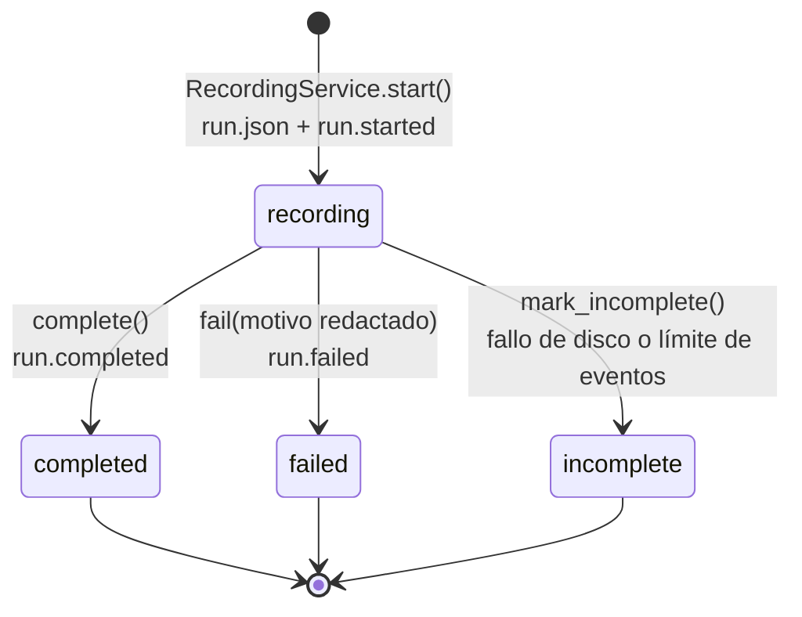

# Ciclo de vida del run

↑ [Diagramas](README.md) · [Memoria central](../README.md)

## Estado grabado vs. estado efectivo

| `run.json` dice | La inspección reporta | Por qué |
|---|---|---|
| `recording` | `incomplete` + «never finalized» | Nadie cerró el run: proceso muerto o aún corriendo |
| `completed` | `completed` | Pero la **completitud** puede ser < 100 % y haber evidencia faltante |
| `failed` | `failed` + motivo | El flujo lanzó una excepción; `run.failed` es el último evento |
| `incomplete` | `incomplete` + motivo | FORKED no pudo seguir capturando y lo declaró |

Toda transición desde un estado terminal lanza `IllegalTransition` (CP-001, CP-007, CP-008).
