# Flujo del experimento (objetivo)

↑ [Diagramas](README.md) · [Memoria central](../README.md)

> Muestra el **objetivo** de las Fases 1–4. Hoy solo existe la captura (verde).

```mermaid
flowchart LR
  A[Flujo base] --> B[Capturar eventos]:::hecho
  B --> C[Artefactos inmutables del run]:::hecho
  C --> D[Elegir checkpoint]
  D --> E[Crear rama]
  E --> F[Declarar intervención]
  F --> G[Ejecutar bajo política de efectos]
  G --> H[Comprobar invariantes]
  H --> I[Comparar resultados]
  I --> J[Paquete de evidencia]
  J --> K[Verificación offline]
  classDef hecho fill:#1f7a3a,color:#fff
```

Cada paso de la derecha añade **una** garantía y su límite; ninguno convierte una diferencia observada en causalidad
sin el diseño experimental que la sostenga ([ADR-003](../forked/decisiones-arquitectura/ADR-003-vocabulario-cip.md)).
