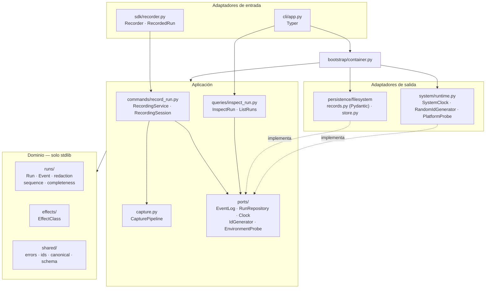

# Hexagonal: capas y dependencias

↑ [Diagramas](README.md) · [Memoria central](../README.md)

La flecha de la aplicación a los adaptadores **no existe**: la aplicación solo ve puertos. Lo vigila
[`test_dependency_rule.py`](../../tests/guardians/test_dependency_rule.py).
