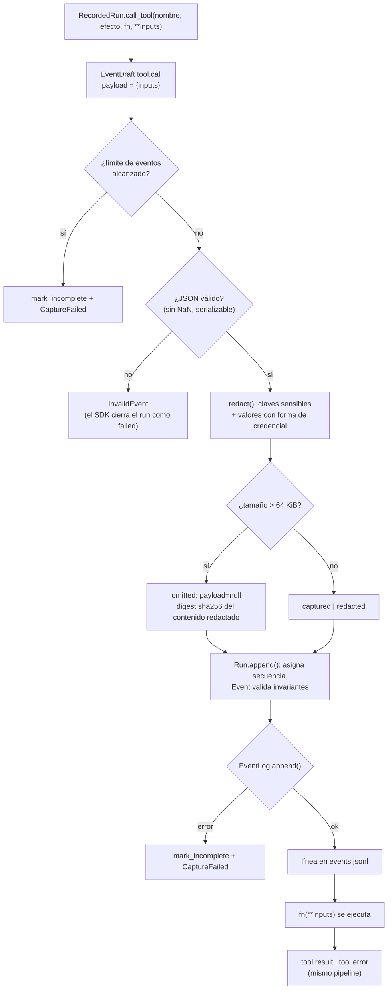

# Pipeline de captura

↑ [Diagramas](README.md) · [Memoria central](../README.md)

Notas: la herramienta **sí se ejecuta** al grabar (la línea base es una ejecución real). Redactar antes de medir evita
que el digest de un secreto quede en disco ([ADR-007](../forked/decisiones-arquitectura/ADR-007-omitir-no-truncar.md)).
