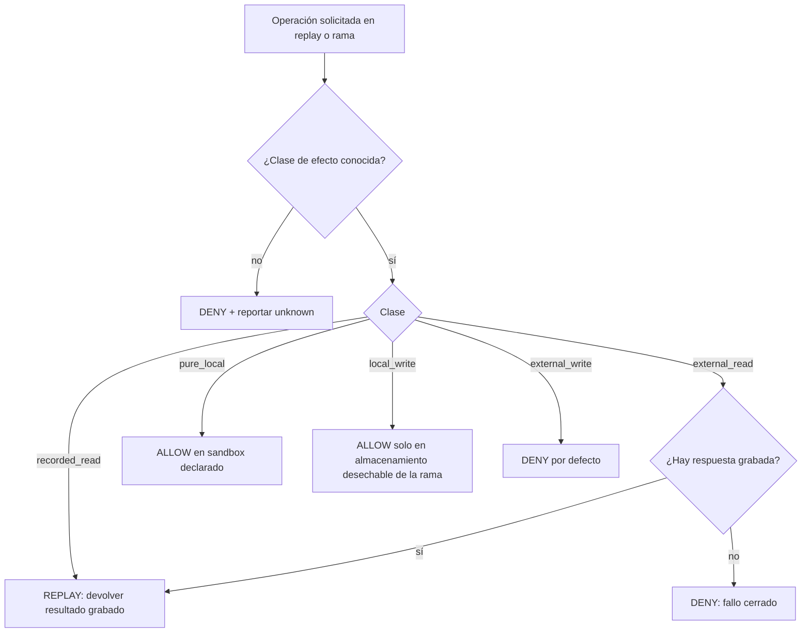

# Política de efectos (objetivo, Fase 2)

↑ [Diagramas](README.md) · [Memoria central](../README.md)

Toda decisión deja un evento de auditoría con versión de política, motivo y alcance. `SIMULATE` existe solo como
decisión **explícita** y queda marcada en la evidencia. Taxonomía: [protocolo](../protocolo/taxonomia-de-efectos.md).
