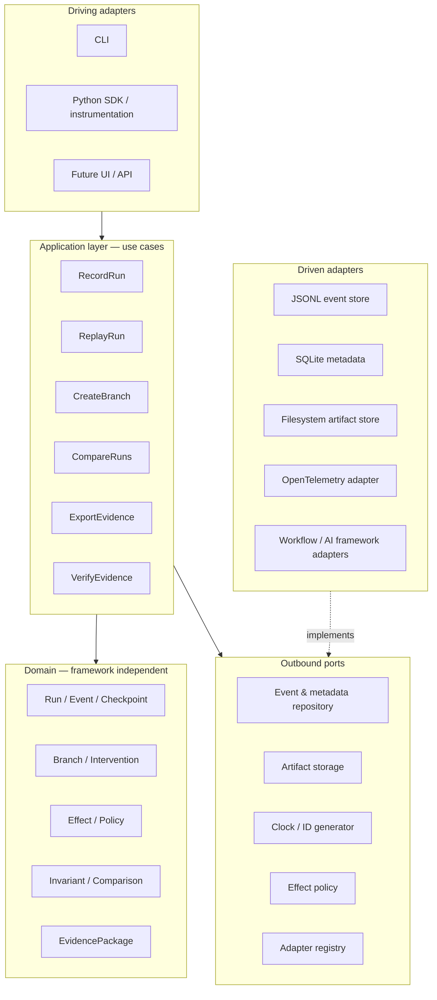

# 5. System Architecture — Hexagonal Modular Monolith

## 5.1 Architectural decision

**FORKED v0 is a modular monolith implemented with Hexagonal Architecture (Ports and Adapters), with explicit domain/application/infrastructure boundaries.** This is the default architecture for all new code unless an Architecture Decision Record (ADR) approves an exception.

The goal is not to accumulate architecture patterns. The goal is to keep the experiment engine testable, offline-first, provider-neutral, and safe while allowing adapters to evolve independently.

### Why this choice
- The domain rules (recording, replay, branching, effects, invariants and evidence) must not depend on Python frameworks, databases, CLI libraries, AI providers or workflow frameworks.
- Ports make external capabilities explicit and replaceable in tests.
- Adapters allow integrations to be added without contaminating the core.
- A modular monolith is easier to develop, test, package and contribute to than early microservices.
- The first release is local-first; a distributed architecture would add operational cost without a demonstrated need.

## 5.2 Patterns to use — and where

| Pattern / approach | Decision | FORKED application |
|---|---|---|
| Hexagonal Architecture (Ports & Adapters) | **Required** | Domain/application depend on ports; infrastructure implements them. |
| Modular Monolith | **Required for v0** | One deployable/package, internally divided by bounded contexts. |
| Domain-Driven Design (DDD), lightweight | **Use selectively** | Explicit domain language, aggregates, value objects and bounded contexts; avoid ceremony. |
| Dependency Injection | **Required, simple** | Compose adapters at application boundaries; domain must not instantiate infrastructure. |
| Repository + Unit of Work | **Use where persistence needs justify it** | Abstract metadata/artifact access; keep transaction boundaries explicit. Do not create generic repositories for every class. |
| Strategy / Policy Object | **Required for effect decisions** | Pluggable effect classification and policy evaluation, with deny-by-default semantics. |
| State Machine | **Recommended** | Validate Run, Replay and Branch lifecycle transitions; reject illegal transitions. |
| Pipeline / Middleware | **Recommended at capture boundary** | Ordered capture, validation, redaction, normalization and persistence stages. |
| Factory / Registry | **Use for adapter discovery** | Resolve registered adapter implementations by stable capability/type identifiers. |
| CQRS | **Limited / later** | Separate write-side event capture from read-optimized reports only if query complexity warrants it. Not a mandate for separate services or databases. |
| Event Sourcing | **Do not adopt as a blanket architecture** | Append-only event artifacts are part of the product, but SQLite metadata and domain state need not be rebuilt from events. |
| Plugin Architecture | **Later, behind stable ports** | Third-party adapters only after the internal adapter contract is proven. |

### Patterns explicitly not recommended for v0
- Microservices, Kubernetes, service mesh, distributed queues and event brokers.
- A generic `BaseRepository[T]` abstraction without a real use case.
- A large framework-driven dependency injection container.
- CQRS with separate write/read databases before read performance requires it.
- Treating every recorded event as a domain event or claiming full event-sourced consistency.
- Premature plugin sandboxing or arbitrary third-party code execution.

## 5.3 Dependency rule

Dependencies point inward only:

1. **Domain** knows business concepts and rules. It imports no infrastructure, CLI, database, framework or provider modules.
2. **Application** orchestrates use cases. It depends on domain types and port interfaces, never on concrete adapters.
3. **Ports** define the capabilities required by use cases (event writer/reader, clock, ID generator, artifact store, policy evaluator, adapter registry, etc.).
4. **Adapters / Infrastructure** implement ports (JSONL, SQLite, filesystem, OpenTelemetry, LangGraph, model providers, CLI, future UI).
5. **Composition root** wires concrete implementations together at startup. It is the only normal place where application code selects infrastructure implementations.

Forbidden dependency direction: `domain -> application`, `domain -> adapters`, `application -> concrete infrastructure`, or framework/provider imports from the core.

## 5.4 Hexagonal logical view



## 5.5 Bounded contexts / modules

Keep modules cohesive and avoid circular dependencies. Initial contexts:

- **Runs & Capture:** run lifecycle, event ordering, adapter capabilities, capture completeness.
- **Replay:** observation lookup and replay session semantics. It never invokes external writes.
- **Branches & Interventions:** immutable parent lineage, checkpoint references and intervention definitions.
- **Effects & Safety:** effect classification, policy evaluation, approvals and deny-by-default enforcement.
- **Comparison & Invariants:** observed differences, invariant evaluation and uncertainty reporting.
- **Evidence:** manifests, hashes, export and offline verification.
- **Integrations:** adapter contracts and concrete framework/provider integrations.
- **Interfaces:** CLI first; optional UI/API later.

These are logical modules in one Python distribution, not separate deployable services.

## 5.6 Recommended Python package layout

```text
src/forked/
  domain/
    runs/                 # entities, value objects, domain rules
    replay/
    branches/
    effects/
    comparison/
    evidence/
    shared/               # stable primitives and domain errors only
  application/
    commands/             # write/use-case handlers
    queries/              # read/report use cases
    dto/                  # application input/output models
    ports/                # protocols/interfaces required by use cases
  adapters/
    inbound/
      cli/
      sdk/
    outbound/
      persistence/
        jsonl/
        sqlite/
        filesystem/
      observability/
      frameworks/
      model_providers/
  bootstrap/              # composition root / dependency wiring
  config/                 # validated configuration; no secrets in artifacts

tests/
  unit/domain/
  unit/application/
  contract/               # every adapter must pass port contract tests
  integration/
  security/
  acceptance/
examples/
spec/
```

A module may start smaller; do not create empty folders or abstractions just to match this tree. Keep public imports stable and internal implementation private where possible.

## 5.7 Domain modeling rules

- Prefer immutable value objects for IDs, hashes, schema versions, effect classifications and lineage references.
- Use explicit aggregates only where invariants must be enforced consistently. Candidate aggregates: `Run`, `Branch`, `EvidencePackage`.
- Aggregate roots own state transitions; do not let CLI or adapters mutate domain objects arbitrarily.
- Use typed domain errors for expected failures (missing observation, illegal transition, denied effect, incompatible schema, incomplete evidence).
- Keep Pydantic or serialization-specific models at boundaries. The domain should not require a serialization library unless a measured benefit justifies it.
- Keep timestamps and IDs behind injectable ports so tests can be deterministic.
- Avoid an anemic model: business invariants belong in domain behavior, not scattered across CLI handlers.

## 5.8 Use-case boundaries

Each application use case should have a narrow input/output contract and coordinate domain behavior through ports. Examples:

- `RecordRun`: validate adapter capabilities → capture/normalize → redact → persist event → update run metadata.
- `ReplayRun`: load immutable recording → create replay session → resolve recorded observations → fail closed when evidence is absent.
- `CreateBranch`: validate checkpoint and parent → apply declared intervention to branch-local view → preserve parent immutability.
- `EvaluateEffect`: classify operation → evaluate policy → return `ALLOW`, `REPLAY`, `SIMULATE` or `DENY` with reason and evidence.
- `CompareRuns`: load selected observations → evaluate invariants → produce descriptive comparison, including unknowns.
- `ExportEvidence`: build versioned manifest → hash artifacts → write package atomically.

No use case should reach directly into SQLite, filesystem paths, HTTP clients, LLM SDKs or framework internals.

## 5.9 Ports and adapter contracts

Define ports as Python `Protocol` interfaces or small abstract contracts. Examples:

- `EventWriter`, `EventReader`
- `RunMetadataRepository`
- `ArtifactStore`
- `Clock`, `IdGenerator`
- `EffectPolicyEvaluator`
- `WorkflowAdapter`, `AdapterRegistry`

Rules:
- Keep interfaces capability-based and minimal; avoid one universal adapter interface with dozens of optional methods.
- Each adapter declares capture capabilities, unsupported features, schema compatibility and side-effect classification.
- Add contract tests that every adapter implementation must pass.
- Translate third-party exceptions into stable FORKED errors at adapter boundaries; do not leak vendor-specific exception types into the domain.
- Provider/framework adapters are optional packages or isolated modules; core installation must work without them.

## 5.10 Persistence and event-log semantics

MVP persistence remains JSONL append-only artifacts plus SQLite metadata index. This does **not** mean the entire application is event-sourced.

- JSONL is the canonical captured observation stream for a run; records are versioned and append-only.
- SQLite stores searchable metadata, branch lineage and indexes; it is rebuildable where practical but not assumed to be the source of every domain decision.
- Artifact payloads may be content-addressed later; do not add this complexity until large payload tests justify it.
- Use repository ports to isolate storage. Keep JSONL/SQLite details in outbound adapters.
- Define atomicity and crash-recovery behavior explicitly. A partially written run must be marked incomplete, never silently treated as complete.

## 5.11 Effect policy as a safety boundary

Effect handling must be a domain policy, not scattered `if` statements in adapters.

- Default `DENY` for unknown operations and external writes.
- Recorded reads resolve from captured observations.
- Pure local computation can execute only within a declared, disposable execution boundary.
- Branch-local writes must be isolated from parent artifacts and host state.
- An allow decision must include policy version, reason, scope and audit event.
- Replay and branch modes must not silently fall back to live network calls.
- Policy tests must cover every effect class and unknown classification.

## 5.12 Testing strategy by architecture layer

- **Domain unit tests:** fast, no filesystem/network/framework dependencies; validate invariants and state machines.
- **Application tests:** fake ports; validate orchestration, failure paths and ordering.
- **Adapter contract tests:** run the same contract suite against JSONL, SQLite and each integration adapter.
- **Integration tests:** real local SQLite/filesystem, isolated temporary directories, no external services.
- **Security tests:** path traversal, secret redaction, malformed event, archive tampering, denied side effects, branch isolation.
- **Acceptance tests:** complete toy workflow from capture to offline evidence verification.

Use dependency rules as an automated check where practical (for example import-linter or an equivalent lightweight tool). Add Hypothesis/property-based tests for event ordering, schema round trips, branch immutability and policy invariants.

## 5.13 Technology choices

Provisional MVP choices:
- Python 3.11+ (confirm supported versions at implementation start).
- Pydantic at input/output and schema boundaries.
- `typing.Protocol` for ports; avoid a heavyweight DI framework.
- SQLite for local metadata; JSONL for event artifacts.
- Typer for CLI.
- pytest, Hypothesis, Ruff and a static type checker.
- OpenTelemetry integration as an adapter/export path, not a replacement for CIP.
- Docker only for an optional demonstration sandbox; unit tests must not require Docker.

Pin and audit dependencies. Validate maintenance, license compatibility and security before adoption.

## 5.14 Evolution triggers

Do not split the monolith based on hypothetical scale. Revisit architecture only when measurable evidence appears, such as:
- independent scaling or release cadence is required for a specific subsystem;
- a storage adapter needs a separate process for fault isolation;
- third-party integrations require a stable plugin boundary;
- concurrent workloads exceed local process constraints;
- security review requires process isolation for untrusted extensions.

Any change requires an ADR with context, alternatives, consequences, migration and tests.

## 5.15 Reliability model

- Atomic writes for manifests and explicit incomplete-run state.
- Append-only event logs and stable lineage IDs.
- Schema version in every event and evidence package.
- Hash verification on import and export.
- Fail-closed behavior on missing observations or unknown effects.
- Explicit partial-capture status.
- No guarantee of deterministic replay beyond the recorded-observation contract.
