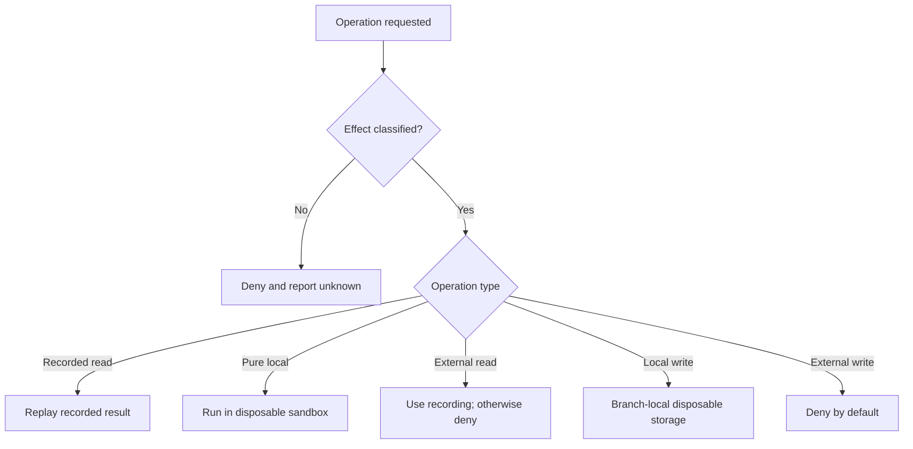
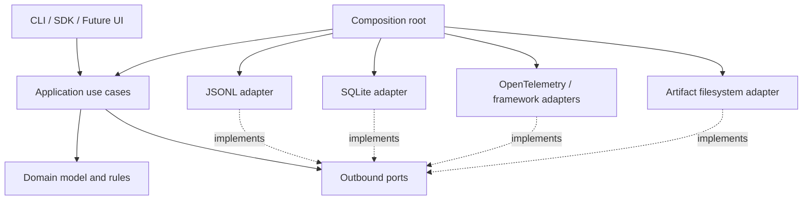

# FORKED Architecture Diagrams

## End-to-end experiment flow

```mermaid
flowchart LR
  A[Baseline workflow] --> B[Capture events]
  B --> C[Immutable run artifacts]
  C --> D[Select checkpoint]
  D --> E[Create branch]
  E --> F[Declare intervention]
  F --> G[Run under effect policy]
  G --> H[Check invariants]
  H --> I[Compare outcomes]
  I --> J[Evidence package]
  J --> K[Offline verification]
```

## Effect policy

## Hexagonal architecture and dependency direction

The arrows from use cases point to abstractions, never to concrete infrastructure. Adapters implement ports. The composition root is the only place that selects and wires concrete implementations.
